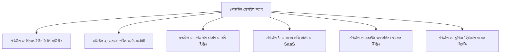

# মা মোটরস গোডাউন কাউন্টিং ও চালান মোবাইল অ্যাপ — পূর্ণাঙ্গ মাস্টার ব্লুপ্রিন্ট
> **উদ্দেশ্য:** নতুন প্রফেশনাল UI/UX ডিজাইন তৈরির পূর্বে সিস্টেমের মূল লক্ষ্য, বিজনেস লজিক এবং সমস্ত ফিচারের এ টু জেড (A to Z) বিস্তারিত স্পেসিফিকেশন।

---

## ১. অ্যাপটি কেন তৈরি করা হচ্ছে? (Background & Core Purpose)

### ১.১ বাস্তব সমস্যা (The Real Problem in Auto Parts Warehouses)
* **ভারী ও জটিল পার্টসের বিশৃঙ্খলা:** চট্টগ্রাম (ভাটিয়ারী) ও ঢাকার অটো পার্টস গোডাউনে প্রতিদিন বড় বড় কন্টেইনার ও ট্রাক থেকে হাজার হাজার পার্টস (যেমন: বিভিন্ন মডেলের হাবস, কার্টিজ, ইঞ্জিন, গিয়ারবক্স, সাসপেনশন) নামানো (Unloading) হয় এবং সারা দেশের কাস্টমারদের জন্য গাড়িতে তোলা (Loading) হয়।
* **কাগজে গোনার মারাত্মক ভুল:** কাগজের খাতা বা মুখে মুখে গুণতে গিয়ে গোডাউনের কর্মীরা প্রায়ই সংখ্যা ভুলে যায়, মনোযোগ হারিয়ে ফেলে বা হিসাবে কাটাকাটি করে। ফলে গাড়িতে মাল বেশি চলে যায় অথবা কম গিয়ে কাস্টমারের সাথে ভুল বোঝাবুঝি ও আর্থিক ক্ষতি হয়।
* **গোডাউনে দুর্বল নেটওয়ার্ক:** গোডাউনগুলো সাধারণত বিশাল টিনের শেড বা আন্ডারগ্রাউন্ডে হওয়ায় সেখানে মোবাইল নেটওয়ার্ক ও ইন্টারনেট প্রায়ই থাকে না। কোনো ক্লাউড-নির্ভর সফটওয়্যার সেখানে কাজ করে না।
* **অশিক্ষিত/অর্ধশিক্ষিত লেবারদের ব্যবহার উপযোগিতা:** গোডাউনের শ্রমিকরা জটিল অ্যাকাউন্টিং সফটওয়্যার বুঝতে পারে না। তাদের প্রয়োজন এমন একটি টুল যা বড় স্ক্রিনে স্পষ্ট দেখা যাবে, হাতে গ্লাভস পরে বা ময়লা হাতেও বড় বাটনে ট্যাপ করা যাবে এবং মুখে সংখ্যা বলে দিলে তারা কানে শুনে নিশ্চিত হতে পারবে।
* **চালান তৈরিতে বিলম্ব:** গণনা শেষে তাৎক্ষণিক গাড়ির নম্বর, ড্রাইভারের স্বাক্ষর ও আইটেম সামারি সহ ডেলিভারি চালান তৈরি করা অত্যন্ত কষ্টসাধ্য।

### ১.২ অ্যাপটির চূড়ান্ত লক্ষ্য (Vision & Solution)
* **১০০% নির্ভুল ডিজিটাল কাউন্টিং:** মোবাইল স্ক্রিনের বড় বৃত্তাকার বাটনে এক আঙুলের ছোঁয়ায় পার্টস গণনা।
* **খাঁটি মানুষের কণ্ঠে ফিডব্যাক:** প্রতি ট্যাপে স্পষ্ট খাঁটি বাংলা উচ্চারণে "এক, দুই, তিন..." বলে নিশ্চিত করবে।
* **১ ক্লিকে প্রফেশনাল চালান (A4/POS/WhatsApp):** গণনা শেষ হওয়ামাত্রই ক্যাটাগরি রোল-আপ (উদা: হাবস মোট: ৪৫ পিস, ইঞ্জিন মোট: ৫ সেট) সহ ডিজিটাল চালান তৈরি।
* **১০০% অফলাইন স্বাধীনতা:** কোনো ইন্টারনেট সংযোগ ছাড়াই অ্যাপ আজীবন নিরবচ্ছিন্নভাবে চলবে।
* **মাল্টি-টেন্যান্ট SaaS মডেল:** শুধু মা মোটরস নয়, দেশের যেকোনো পার্টসের দোকানদার নিজস্ব ব্যানার ও নাম দিয়ে তাদের গোডাউনের কর্মীদের এই অ্যাপ দিয়ে পরিচালনা করতে পারবে, এবং ওনার (ওমর ফারুক) দূর থেকে সেন্ট্রাল সুপার অ্যাডমিন কন্ট্রোল পরিচালনা করবেন।

---

## ২. অ্যাপের সমস্ত ফিচারের বিস্তারিত তালিকা (Complete Feature Inventory)

সিস্টেমটিকে মোট **৬টি প্রধান মডিউলে** ভাগ করা হয়েছে:



---

### 🔹 মডিউল ১: মূল কাউন্টার ও ট্যালি ইন্টার‍্যাকশন ইঞ্জিন (Core Counter)

| ফিচার নম্বর | ফিচারের নাম | বিস্তারিত কার্যপদ্ধতি ও লজিক |
| :--- | :--- | :--- |
| **১.১** | **বড় বৃত্তাকার কাউন্টার বাটন (Big Tap Circle)** | স্ক্রিনের কেন্দ্রে বড় গোলাকার বাটন। গোডাউনে মাল তোলার সময় একহাতে ফোন ধরে সহজে যেকোনো জায়গায় ট্যাপ করলে সংখ্যা ১ করে বৃদ্ধি (+1) পাবে। |
| **১.২** | **হ্যাপটিক ভাইব্রেশন (Tactile Feedback)** | প্রতিবার ট্যাপে ফোনে মৃদু ঝাঁকুনি (Haptic Vibration) হবে, যাতে স্ক্রিনের দিকে না তাকিয়েও মাল তোলার সময় নিশ্চিত হওয়া যায় যে ট্যাপ পড়েছে। |
| **১.৩** | **ভয়েস সাউন্ড টগল (Sound ON / Vibration Only)** | স্ক্রিনের কোণায় একটি সাউন্ড টগল বাটন। চালু থাকলে প্রতি ট্যাপে সংখ্যা বলবে, বন্ধ থাকলে সম্পূর্ণ নিঃশব্দে কেবল ভাইব্রেশন হবে। |
| **১.৪** | **আনডু ও রিডু স্ট্যাক (Undo ↩ & Redo ↪)** | ভুলবশত বেশি ট্যাপ লেগে গেলে সাথে সাথে `Undo` চেপে পেছনের সংখ্যায় ফেরত যাওয়া যাবে। আবার ভুলে আনডু চাপলে `Redo` দিয়ে ফিরিয়ে আনা যাবে। |
| **১.৫** | **লাইভ সেশন প্রোগ্রেস ও একক ডিসপ্লে** | বড় সংখ্যার নিচে বর্তমান নির্বাচিত আইটেমের নাম ও একক (উদা: "১৫ পিস" বা "৪ সেট") স্পষ্ট ফুটে উঠবে। |
| **১.৬** | **আইটেম কমপ্লিট অ্যাকশন (OK বাটন)** | নির্দিষ্ট পার্টস গোনা শেষ হলে `✓ এই পণ্য গণনা সম্পন্ন (OK)` চাপলে ওই আইটেমের সংখ্যা চালানের তালিকায় যোগ হয়ে যাবে এবং কাউন্টার ০ হয়ে নতুন আইটেমের জন্য রেডি হবে। |

---

### 🔹 মডিউল ২: ৬০৯+ দেশীয় পার্টস ক্যাটালগ ও লাইভ অটো-কমপ্লিট (Parts Autocomplete)

| ফিচার নম্বর | ফিচারের নাম | বিস্তারিত কার্যপদ্ধতি ও লজিক |
| :--- | :--- | :--- |
| **২.১** | **টাইপ-অ্যাহেড সাজেশন (Type-Ahead Search)** | ৬০৯টি দেশীয় অটোপার্টসের ডাটাবেস। ইনপুটে মাত্র ১-২ অক্ষর লিখলেই (যেমন: "হা" লিখলে "হাবস", "Axio হাবস", "Fielder হাবস") সাথে সাথে ড্রপডাউন সাজেশন আসবে। |
| **২.২** | **অটো ইউনিট নির্ধারণ (Smart Unit Detection)** | কোনো পার্টস সিলেক্ট করামাত্রই সফটওয়্যার নিজে বুঝে নেবে এটি "পিস" নাকি "সেট" (যেমন: ইঞ্জিন হলে স্বয়ংক্রিয়ভাবে 'সেট', হাবস বা কার্টিজ হলে 'পিস')। |
| **২.৩** | **কুইক-পিক চিপস (Quick Chips)** | স্ক্রিনের ওপরে সবচেয়ে বেশি ব্যবহৃত ৫-৬টি পার্টস (হাবস, কার্টিজ, ইঞ্জিন, গিয়ারবক্স) শর্টকাট বাটন আকারে থাকবে, যাতে না লিখেও ১ ক্লিকে সিলেক্ট করা যায়। |
| **২.৪** | **নতুন কাস্টম পার্টস যুক্ত করার স্বাধীনতা** | যদি কোনো আনকমন পার্টস ক্যাটালগে না থাকে, তবে ব্যবহারকারী নিজে যেকোনো নাম টাইপ করে তাৎক্ষণিক তালিকাভুক্ত করতে পারবে। |

---

### 🔹 মডিউল ৩: গোডাউন চালান ও প্রিন্ট ইঞ্জিন (Challan Generation & Print)

| ফিচার নম্বর | ফিচারের নাম | বিস্তারিত কার্যপদ্ধতি ও লজিক |
| :--- | :--- | :--- |
| **৩.১** | **সেশন নির্বাচন (Loading vs Unloading)** | চালান তৈরির শুরুতে বেছে নেওয়া যাবে: **"গাড়ি থেকে নামানো (Unloading)"** নাকি **"গাড়িতে মাল তোলা (Loading/Delivery)"**। |
| **৩.২** | **গাড়ির মেটাডাটা এন্ট্রি** | চালানের জন্য প্রয়োজনীয় তথ্য: চালান নম্বর (অটো-সিরিয়াল), তারিখ ও সময়, গাড়ি নম্বর (উদা: চট্র-মেট্রো ড-১১-...), ড্রাইভারের নাম ও মোবাইল, পণ্যের মালিক/পার্টি, গন্তব্য (Destination)। |
| **৩.৩** | **ক্যাটাগরি ভিত্তিক স্বয়ংক্রিয় সামারি (Category Roll-up)** | চালানের উপরে একটি সামারি বক্স থাকবে যেখানে স্বয়ংক্রিয় গ্রুপ যোগফল দেখাবে (যেমন: বিভিন্ন মডেলের হাবস মিলিয়ে মোট: ৪৫ পিস, সকল কার্টিজ মিলিয়ে: ৬০ পিস, ইঞ্জিন: ৫ সেট)। |
| **৩.৪** | **বিস্তারিত আইটেম টেবিল** | চালানের মূল বডিতে প্রতিটি পার্টসের নাম, পরিমাণ এবং একক সুনির্দিষ্ট টেবিলে তালিকাভুক্ত থাকবে। |
| **৩.৫** | **৩টি প্রাতিষ্ঠানিক সিগনেচার ব্লক** | চালানের নিচে ৩টি আলাদা সিগনেচার এরিয়া: <br>১. মাল গণনাকারীর স্বাক্ষর (Counted by Staff)<br>২. ড্রাইভারের স্বাক্ষর বা টিপসই (Driver Signature)<br>৩. রিসিভার বা গোডাউন ইনচার্জের স্বাক্ষর (Incharge/Receiver)। |
| **৩.৬** | **মাল্টি-ফরম্যাট প্রিন্টিং ও শেয়ারিং** | • A4 সাইজ প্রফেশনাল পেপার প্রিন্ট<br>• ব্লুটুথ থার্মাল পিওএস প্রিন্টার (POS Print)<br>• ১-ক্লিকে সরাসরি হোয়াটসঅ্যাপে PDF শেয়ার। |
| **৩.৭** | **চালান হিস্ট্রি ও আর্কাইভ** | পূর্বে তৈরি হওয়া সকল চালানের ডিজিটাল রেকর্ড স্থানীয়ভাবে সংরক্ষিত থাকবে। যেকোনো সময় সার্চ করে রি-প্রিন্ট করা যাবে। |

---

### 🔹 মডিউল ৪: ৩-স্তরের মাল্টি-টেন্যান্ট সিকিউরিটি ও SaaS আর্কিটেকচার (Multi-Tenant SaaS)

| লেভেল | ব্যবহারকারীর রোল | সুযোগ-সুবিধা ও অ্যাক্সেস কন্ট্রোল |
| :--- | :--- | :--- |
| **লেভেল ১** | **ফ্রি ইউজার (Free Public Tier)** | যেকোনো সাধারণ ইউজার অ্যাপ ইনস্টল করে কোনো পাসওয়ার্ড ছাড়াই সম্পূর্ণ ফ্রিতে বেসিক ট্যালি কাউন্টার হিসেবে আনলিমিটেড ব্যবহার করতে পারবে। |
| **লেভেল ২** | **শপ/গোডাউন অ্যাডমিন (Shop Admin)** | ওনারের কাছ থেকে পাওয়া ডেডিকেটেড আইডি ও সিক্রেট পাসওয়ার্ড দিয়ে জীবনে মাত্র ১ বার অনলাইনে এসে লগইন করবে। সাথে সাথে ফোনে লাইসেন্স টোকেন সেভ হবে এবং সারাজীবন ইন্টারনেট ছাড়া অফলাইনে চলবে। নিজস্ব গোডাউনের নাম ও ১২০০x২৪০ ব্যানার সহ আনলিমিটেড চালান প্রিন্ট করতে পারবে। |
| **লেভেল ৩** | **সুপার অ্যাডমিন হাব (Owner Central Control)** | ওনার (`omarfarukitbd@gmail.com`) দিয়ে লগইন করলেই স্বয়ংক্রিয়ভাবে সুপার অ্যাডমিন হাব দৃশ্যমান হবে। এখান থেকে ওনার:<br>• নতুন দোকানের একাউন্ট তৈরি করতে পারবেন<br>• ১ ক্লিকে সিক্রেট পাসওয়ার্ড জেনারেট করে ক্লায়েন্টকে দিতে পারবেন<br>• ক্লায়েন্ট টাকা না দিলে যেকোনো সময় লাইসেন্স স্থগিত (Suspend) বা ডিলিট করতে পারবেন। |
| **পাসওয়ার্ড-লেস স্টাফ পেয়ারিং** | **কর্মীদের QR কোড কানেকশন** | গোডাউনের লেবার/স্টাফদের কোনো পাসওয়ার্ড টাইপ করতে হবে না। অ্যাডমিনের ফোনের স্ক্রিনে থাকা QR কোড স্টাফদের ফোন দিয়ে স্ক্যান করলেই স্বয়ংক্রিয়ভাবে গোডাউনের সাথে পেয়ার হয়ে যাবে। অ্যাডমিন নির্ধারণ করবে কর্মীরা চালান প্রিন্ট করতে পারবে কি না। |

---

### 🔹 মডিউল ৫: ১০০% অফলাইন স্টোরেজ ও রেজিলিয়েন্স ইঞ্জিন (Offline Engine)

| ফিচার নম্বর | ফিচারের নাম | বিস্তারিত কার্যপদ্ধতি ও লজিক |
| :--- | :--- | :--- |
| **৫.১** | **লোকাল ডাটাবেস পারসিস্টেন্স** | অ্যাপের কোনো ডাটার জন্যই লাইভ ইন্টারনেটের প্রয়োজন নেই। অফলাইন স্টোরেজে পার্টস ক্যাটালগ, চলমান গণনা এবং বিগত চালানসমূহ সম্পূর্ণ নিরাপদ থাকবে। |
| **৫.২** | **ফোন বন্ধ বা ক্র্যাশ সেফটি** | গণনা চলাকালীন যদি ফোনের চার্জ শেষ হয়ে বন্ধ হয়ে যায়, পুনরায় ফোন চালু করলে যে সংখ্যা পর্যন্ত গোনা হয়েছিল, ঠিক সেখান থেকেই কাউন্টার শুরু হবে। ১ পিস মালও মিস হবে না। |

---

### 🔹 মডিউল ৬: প্রফেশনাল স্টুডিও হিউম্যান ভয়েস সিস্টেম (Studio Human Voice)

| ফিচার নম্বর | ফিচারের নাম | বিস্তারিত কার্যপদ্ধতি ও লজিক |
| :--- | :--- | :--- |
| **৬.১** | **খাঁটি দেশীয় মানুষের কণ্ঠ (Real Human Voice)** | কোনো আমেরিকান এআই বা রোবট নয়, ব্যবহারকারীর দেওয়া রেকর্ডিং থেকে ১ থেকে ১০০ পর্যন্ত প্রতিটি সংখ্যা মানুষের আসল স্পষ্ট উচ্চারণে বাজবে। |
| **৬.২** | **স্টুডিও নয়েজ রিমুভাল ও ভলিউম বুস্টিং** | ব্যাকগ্রাউন্ড ফ্যানের শব্দ ফিল্টার করে এবং ভলিউম সর্বোচ্চ লাউড করে গোডাউনের কোলাহলের মধ্যেও শোনার উপযোগী করা। |
| **৬.৩** | **জিরো-ল্যাটেন্সি প্লেব্যাক (Instant 0ms)** | স্ক্রিনে ট্যাপ লাগামাত্রই কোনো মিলি-সেকেন্ড দেরি না করে সাথে সাথে মুখে "এক", "দুই" আওয়াজ বের হবে। |

---

## ৩. ডেটাবেস ও স্ক্রিন ফ্লো আর্কিটেকচার (Information Architecture)

```
[অ্যাপ লঞ্চ]
   ├── [টপ বার]: গোডাউনের নাম / ব্যানার | পার্টস অটো-কমপ্লিট সার্চ | সাউন্ড অন-অফ টগল
   ├── [মূল বডি]:
   │     ├── কুইক পার্টস চিপস (হাবস, কার্টিজ, ইঞ্জিন...)
   │     ├── কেন্দ্রীয় বড় বৃত্তাকার কাউন্টার বাটন (+1)
   │     ├── আনডু (Undo) ও রিডু (Redo) কন্ট্রোল
   │     └── 'গণনা শেষ (OK)' বাটন
   ├── [ড্রয়ার / সেটিংস মেনু]:
   │     ├── শপ প্রোফাইল ও ১২০০x২৪০ ব্যানার আপলোড
   │     ├── স্টাফদের জন্য QR কোড পেয়ারিং কার্ড
   │     ├── চালান হিস্ট্রি ও রিপোর্ট
   │     └── সুপার অ্যাডমিন হাব (শুধুমাত্র ওনারের অ্যাকাউন্টে দৃশ্যমান)
   └── [চালান ভিউ / প্রিন্ট স্ক্রিন]:
         ├── চালানের হেডার (ব্যানার, মেটাডাটা, তারিখ, গাড়ি নং)
         ├── ক্যাটাগরি রোল-আপ সামারি কার্ড
         ├── আইটেম ওয়াইজ বিস্তারিত টেবিল
         ├── ৩টি স্বাক্ষর ব্লক (স্টাফ, ড্রাইভার, ইনচার্জ)
         └── অ্যাকশন: A4 প্রিন্ট | ব্লুটুথ POS | হোয়াটসঅ্যাপ শেয়ার
```

---

## ৪. আপনার নতুন UI ডিজাইনের জন্য গুরুত্বপূর্ণ নির্দেশনা

যেহেতু আপনি নতুন একটি চমৎকার ও আধুনিক UI ডিজাইন তৈরি করে দেবেন, তাই ডিজাইনে নিচের বিষয়গুলো মাথায় রাখা বিশেষভাবে জরুরি:

1. **বড় ও স্পর্শযোগ্য এলিমেন্ট:** গোডাউনের কর্মীদের কথা চিন্তা করে কাউন্টার বাটন ও প্রধান অ্যাকশন বাটনগুলো যথেষ্ট বড় ও স্পষ্ট হতে হবে।
2. **একহাতে ব্যবহারের সুবিধা (One-Handed Ergonomics):** অধিকাংশ সময় শ্রমিকরা একহাতে ফোন ধরে মালামাল গুনে থাকেন, তাই প্রধান ইন্টার‍্যাকশন স্ক্রিনের নিচের অর্ধেক অংশে থাকা বাঞ্ছনীয়।
3. **উচ্চ বৈসাদৃশ্য (High Contrast Dark Theme):** গোডাউনের বিভিন্ন আলোর অবস্থা (অন্ধকার বা প্রখর রোদ) বিবেচনায় ডিপ ডার্ক বা ক্লিন হাই-কনট্রাস্ট ইন্টারফেস চোখের জন্য আরামদায়ক হবে।
4. **কোনো কাঁচা ইমোজি নয়:** সব জায়গায় প্রফেশনাল ভেক্টর আইকন (FontAwesome / Material Icons) ব্যবহার করতে হবে।

---
> 📄 *এই ফাইলটি আপনার রেফারেন্স ও নতুন UI ডিজাইন পরিকল্পনার জন্য স্থায়ী ব্লুপ্রিন্ট হিসেবে সংরক্ষিত থাকবে।*
